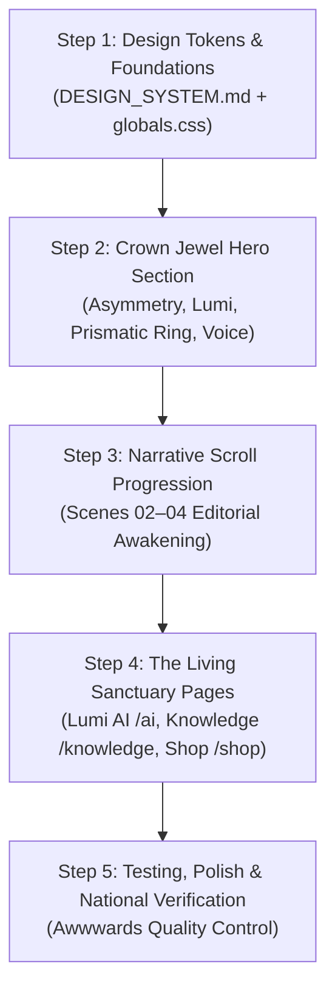

# BLOOMCARE AI — MASTER IMPLEMENTATION PLAN
**Project:** BloomCare AI Web Experience  
**Methodology:** Phased Co-Creation & Continuous Verification  

---

## 🏁 ROADMAP MATRIX

---

## 📌 DETAILED STAGE PROGRESS

### [x] Stage 0: Audit & Architecture Strategy
* Completed 10-point Awwwards audit.
* Formulated "A Living Digital Sanctuary" creative thesis.
* Received user green light to proceed step-by-step.

### [/] Stage 1: Design System Foundation (IN PROGRESS)
* [x] Author `DESIGN_SYSTEM.md`.
* [x] Author `ART_DIRECTION.md`.
* [x] Author `MOTION_GUIDELINES.md`.
* [x] Author `IMPLEMENTATION_PLAN.md`.
* [ ] Update `src/app/globals.css` with sacred palette tokens, optical glass utilities, and editorial typography rules.

### [ ] Stage 2: The Crown Jewel Hero Section
* [ ] Elevate `src/components/scenes/Scene01Hero.tsx`:
  * Integrate multi-layered atmospheric lighting (warm morning fog + celestial sunrise).
  * Refine Lumi 3D character integration with soft ambient occlusion and environmental rim light.
  * Perfect the 3D rotating prismatic crystal ring with optical refraction and starry particle trails.
  * Upgrade editorial typography hierarchy with high-contrast Playfair Display & Anuphan Thai text.
  * Enhance the 4 frosted-glass voice capsules with tactile micro-interactions and audio-visual resonance.
* [ ] Test & inspect live in browser on `http://localhost:3000`.

### [ ] Stage 3: Narrative Scroll Progression (Scenes 02–04)
* [ ] Scene 02: Transform from rounded card into Kinetic Typography Sculpture.
* [ ] Scene 03: Transform into 3-column Editorial Luxury Magazine Spread with oversized indices.
* [ ] Scene 04: Transform into the Sculptural 3D Product Pedestal with studio lighting and discreet packaging guarantee.

### [ ] Stage 4: Core Experience Pages
* [ ] `/ai`: Introduce Lumi as an active 3D companion in the consultation sanctuary.
* [ ] `/knowledge`: Build the Editorial Digital Health Magazine with verified medical facts.
* [ ] `/shop` & `/cart`: Elevate the 3D product exhibition and discreet checkout flow.

### [ ] Stage 5: Final Verification & Performance
* [ ] Verify responsive layout on mobile, tablet, and widescreen.
* [ ] Verify Web Speech API, Web Audio API, and reduced-motion states.
* [ ] Run production build and lighthouse performance checks.
